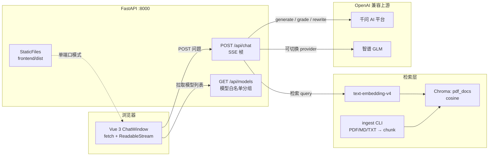
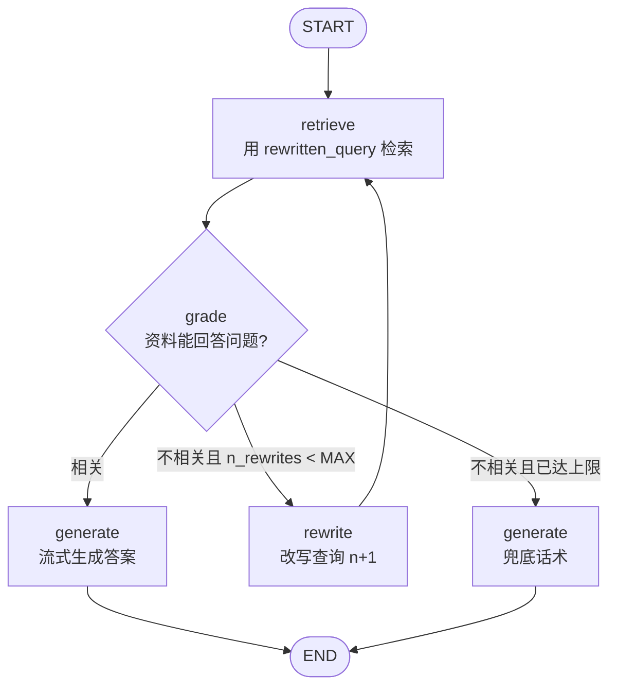
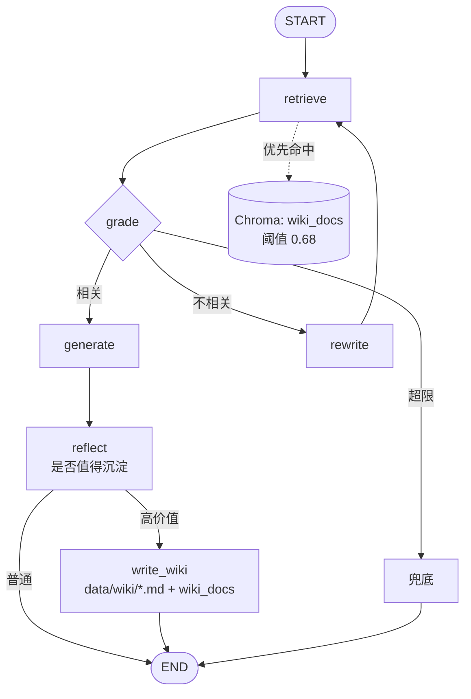

# wiki-agent 架构（V2.0）

> 图用 Mermaid 编写，GitHub 与 VS Code（Mermaid 插件）可直接渲染。
> 版本演进与验收记录见 [plan.md](./plan.md)。

## 1. 部署与数据流总览



## 2. V1.0 直线 RAG


前端 SSE 帧：`sources → token… → done`。

## 3. V2.0 LangGraph 状态机（当前）



要点：

| 项 | 实现 |
|---|---|
| State | `question / rewritten_query / docs / relevant / n_rewrites / answer`（TypedDict） |
| Grade | LLM 结构化输出 `GradeVerdict{relevant, reason}`，`method="function_calling"`；失败退回相似度阈值 0.30 |
| Rewrite | HyDE 风格改写，最多 `MAX_REWRITES=2` 次，硬上限防死循环 |
| 兜底 | 重写用尽仍不相关 → 不调 LLM，直接流 `FALLBACK_ANSWER` |
| 流式 | 节点内 `get_stream_writer()` 写帧，图用 `astream(stream_mode="custom")` 消费 |

前端 SSE 帧（向后兼容，只新增 `trace`）：

```text
data: {"type":"sources","refs":[{"source":"hr.pdf","page":3,"score":0.438}]}
data: {"type":"trace","node":"retrieve"}
data: {"type":"trace","node":"grade","relevant":false,"reason":"..."}
data: {"type":"trace","node":"rewrite","query":"差旅报销 发票 审批"}
data: {"type":"trace","node":"retrieve"}
data: {"type":"trace","node":"grade","relevant":true,"reason":"..."}
data: {"type":"trace","node":"generate","fallback":false}
data: {"type":"token","text":"需提供"}
data: {"type":"done"}
```

## 4. V3.0 规划（虚线为未实现）


