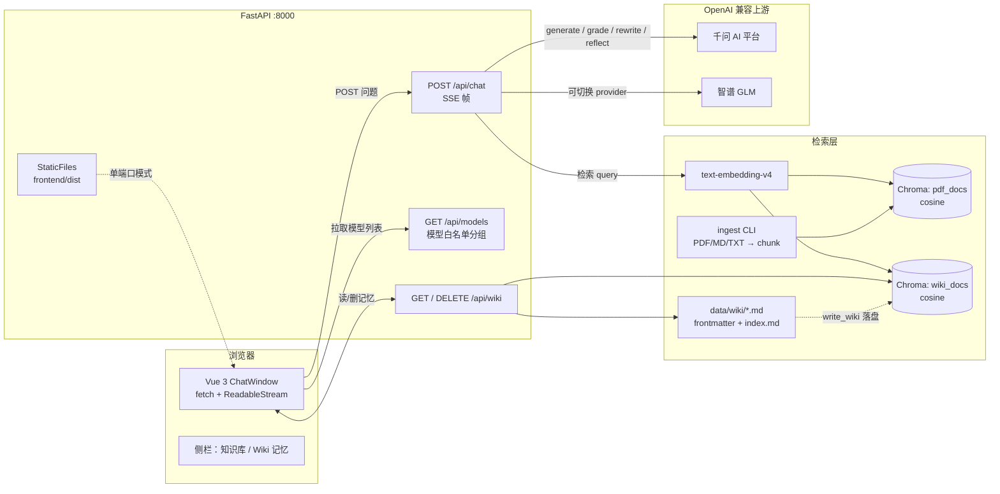
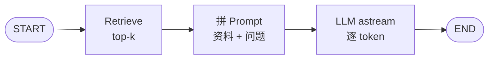
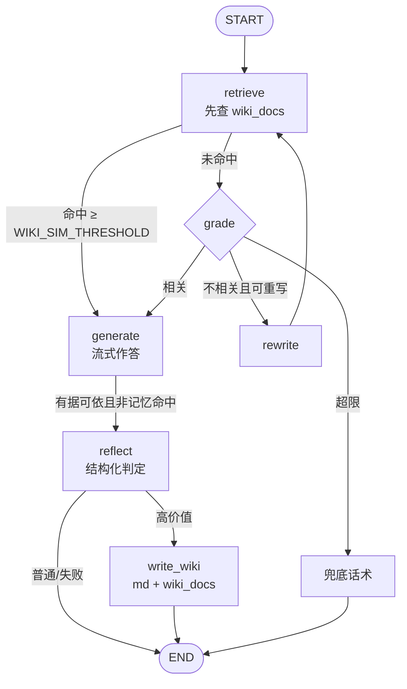

# wiki-agent 架构（V3.0）

> 图用 Mermaid 编写，GitHub 与 VS Code（Mermaid 插件）可直接渲染。
> 版本演进与验收记录见 [plan.md](./plan.md)。

## 1. 部署与数据流总览



## 2. V1.0 直线 RAG



前端 SSE 帧：`sources → token… → done`。

## 3. V2.0 LangGraph 自我纠错


| 项 | 实现 |
|---|---|
| State | `question / rewritten_query / docs / relevant / n_rewrites / answer`（TypedDict） |
| Grade | LLM 结构化输出 `GradeVerdict{relevant, reason}`，`method="function_calling"`；失败退回相似度阈值 0.30 |
| Rewrite | HyDE 风格改写，最多 `MAX_REWRITES=2` 次，硬上限防死循环 |
| 兜底 | 重写用尽仍不相关 → 不调 LLM，直接流 `FALLBACK_ANSWER` |

## 4. V3.0 Wiki 记忆闭环（当前）



| 项 | 实现 |
|---|---|
| 记忆存储 | `data/wiki/{sha1(title)[:10]}.md`（frontmatter: title/question/slug/created_at/updated_at/summary/sources）+ `index.md`；向量集合 `wiki_docs` |
| 优先检索 | `retrieve` 先查 `wiki_docs`，相似度 ≥ `WIKI_SIM_THRESHOLD`(0.68) 直接 `generate`，跳过 grade 与 PDF 检索 |
| Reflect | `ReflectVerdict{worth, title, summary}` 结构化输出；失败/不支持 tool calling → 静默不沉淀 |
| 去重 | ①同一问题文本复用 slug；②标题向量相似 ≥ `WIKI_DEDUPE_THRESHOLD`(0.92) 复用；③合并 sources 而非新增 |
| 写入 | 先落 md（事实来源），再 upsert `wiki_docs`；向量同步失败只影响下次命中，不影响回答 |
| 可观测 | trace 帧新增 `retrieve.from_wiki` / `reflect.worth` / `write_wiki.slug,merged`；sources.refs 新增 `kind` |
| 人工干预 | `GET /api/wiki` 列表、`DELETE /api/wiki/{slug}` 同时删 md 与向量 |

SSE 帧（V2 基础上只新增 trace 与 kind，前端向后兼容）：

```text
data: {"type":"sources","refs":[{"source":"wiki/1a2b3c4d5e.md","page":null,"score":0.81,"kind":"wiki"}]}
data: {"type":"trace","node":"retrieve","from_wiki":true}
data: {"type":"trace","node":"generate","fallback":false}
data: {"type":"token","text":"需提供"}
data: {"type":"done"}
```

V2 路径新增尾部两帧：

```text
data: {"type":"trace","node":"reflect","worth":true,"title":"差旅报销材料"}
data: {"type":"trace","node":"write_wiki","slug":"1a2b3c4d5e","merged":false}
```
