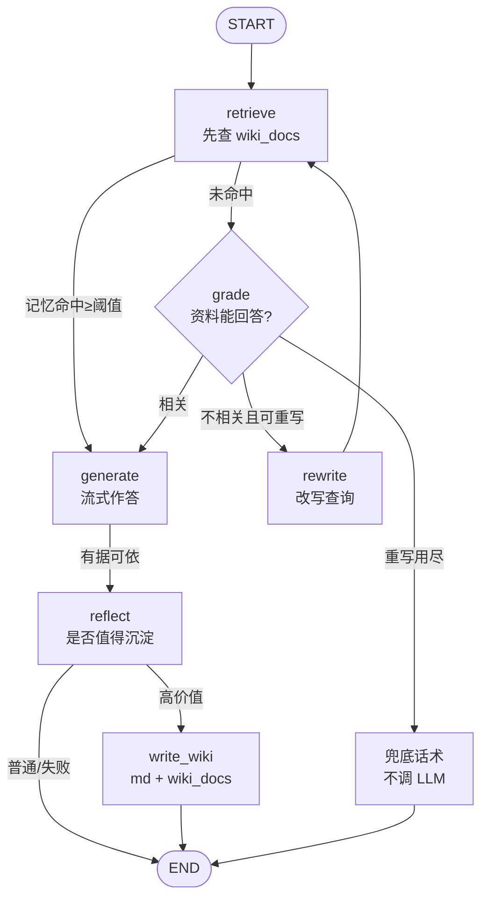

# wiki-agent · Fount 知源

一个**会自我纠错、会把答案沉淀成长期记忆**的企业知识库问答 Agent。

> V1 全栈流式 RAG → V2 LangGraph 自我纠错状态机 → V3 LLM Wiki 记忆闭环。
> 不需要 Docker、不需要向量数据库服务：一条命令拉起前后端。

## 亮点

| | 能力 | 说明 |
|---|---|---|
| 🔍 | **流式 RAG** | FastAPI SSE + Vue 3 `ReadableStream`，逐 token 打字机，来源可溯源到页 |
| 🔁 | **自我纠错** | 检索不相关时自动 Query Rewrite 重试（最多 2 次），仍无依据就如实说「资料未覆盖」，不硬编 |
| 🧠 | **Wiki 记忆** | 高质量问答自动沉淀为 `data/wiki/*.md` + 独立向量集合；下次同类问题**命中记忆直接作答**，跳过文档检索 |
| 🧹 | **记忆去重** | 同一问题直接复用、标题向量相似则合并来源，防止低质记忆把检索带进回声室 |
| 🎛 | **多 Provider** | 千问 AI 平台 / 智谱 GLM 等多套 base_url + key，前端下拉切换，后端白名单校验 |
| 📦 | **开箱即跑** | 复用 conda env，`start.bat` 双击即用；Docker Compose 作为可选交付物 |

## 实测输出（真实模型，语料 112 chunk）

```text
# 用例 1：资料里有答案
[0.27s] sources 帧: 4 条 -> sample-handbook.md(0.438), 民间菜谱.pdf#5(0.263), ...
[1.03s] 首个 token: 需提供
[1.23s] done 帧
答案: 需提供发票原件与行程单，审批周期为五个工作日。

# 用例 2：资料里没有答案（触发自我纠错）
retrieve → grade(relevant=false) → rewrite ×2 → 兜底
6.67s 返回「当前资料未覆盖该问题…」，全程无 error 帧

# 用例 3：第二次问同一个问题（命中 Wiki 记忆）
sources 首条: wiki/<slug>.md(0.8x)   ← 不打 PDF 检索，也不走 grade
```

## 架构



更完整的部署图、SSE 协议与各版本演进见 [.doc/architecture.md](.doc/architecture.md)。

## 快速开始

### 1. 环境（复用 conda，不用 Docker）

```powershell
conda env create -f environment.yml     # 已存在 langchain1.2 则跳过
conda activate langchain1.2
pip install -r backend/requirements.txt
```

### 2. 配置

```powershell
copy backend\.env.example backend\.env
# 至少填写 LLM_API_KEY / LLM_BASE_URL / LLM_MODEL / EMBEDDING_*
```

> Embedding **必须显式配置**。Chroma 缺省会静默使用英文模型 `all-MiniLM-L6-v2`，
> 中文检索实测几乎不可用；代码里检测到缺省会直接报错，不会静默降级。

### 3. 放语料 + 启动

```powershell
# 把 PDF / MD / TXT 放进 data/pdfs/（首次可复制 data/pdfs-example/ 里的示例）
copy data\pdfs-example\*.md data\pdfs\

.doc\start.bat            # 单端口 http://127.0.0.1:8000（前后端一起）
.doc\start.bat dev        # 开发模式，前端 http://localhost:5173 热更新
.doc\start.bat ingest     # 强制重建向量库
.doc\start.bat check      # 环境与配置自检
```

Linux / macOS 或无 `start.bat` 习惯时：

```powershell
.\scripts\start-dev.ps1            # 后端 :8000 + 前端 :5173，Ctrl+C 一起退出
.\scripts\start-dev.ps1 -BackendOnly
.\scripts\ingest.ps1               # 语料指纹没变会自动跳过
.\scripts\test.ps1                 # 离线测试
```

启动时只用**相对路径**的语料指纹（文件名/大小/mtime/切分参数）比对
`data/chroma/corpus_stamp.json`，语料没变就不会调用 Embedding API 重建索引。

## 使用

- **提问**：回车发送，Shift+Enter 换行；答案下方显示「思考路径」与「参考来源」。
- **切模型**：输入框右侧下拉框，候选来自 `GET /api/models`（按 provider 分组）。
- **知识入库**：左侧「知识库」→ 上传 PDF/MD/TXT → 自动切分入库。
- **Wiki 记忆**：左侧「Wiki 记忆」查看已沉淀条目（标题/问题/来源/日期），可人工删除低质记忆。

## API

| 方法 | 路径 | 用途 |
|---|---|---|
| POST | `/api/chat` | SSE 流式问答，帧类型 `sources / trace / token / error / done` |
| GET | `/api/models` | 默认模型 + 按 provider 分组的白名单 |
| GET | `/api/knowledge` | 语料文件与每个文件的片段数 |
| POST | `/api/ingest/upload` | 上传 PDF/MD/TXT 并重建索引 |
| GET | `/api/wiki` | 已沉淀记忆列表 |
| DELETE | `/api/wiki/{slug}` | 删除某条记忆（md + 向量） |
| GET | `/api/health` | 健康检查 |

SSE 帧示例：

```text
data: {"type":"sources","refs":[{"source":"wiki/abc123.md","page":null,"score":0.81,"kind":"wiki"}]}
data: {"type":"trace","node":"retrieve","from_wiki":true}
data: {"type":"token","text":"需提供"}
data: {"type":"done"}
```

## 目录

```text
backend/app/
  agents/rag_graph.py    # V3 状态图：wiki 优先 → grade/rewrite → generate → reflect
  agents/wiki_writer.py  # Reflect 判定 + 落盘/去重
  agents/prompts.py      # 所有 prompt 集中管理
  rag/wiki.py            # data/wiki/*.md 读写 + wiki_docs 检索/upsert
  rag/vectorstore.py     # Chroma 封装（pdf_docs / wiki_docs，cosine 强校验）
  api/{chat,wiki,ingest}.py
frontend/src/            # Vue 3 + Vite，零新增 Markdown/SSE 依赖
data/
  pdfs/                  # 本地语料（整目录 gitignore）
  pdfs-example/          # 可公开的虚构示例
  wiki/                  # 运行时沉淀的真实记忆（整目录 gitignore，别提交）
  wiki-example/          # 可公开的 Wiki 条目格式示例
scripts/                 # start-dev / ingest / test
.doc/                    # plan.md、architecture.md、start.bat
```

## 测试

```powershell
.\scripts\test.ps1        # 等价于 cd backend; pytest tests -q
```

全离线：假 embedding（字面 bigram 哈希）+ 假模型，不联网、不花额度。
当前覆盖：切分入库、检索阈值、SSE 帧协议、模型白名单、三条纠错路由、Wiki 读写/去重/优先检索/Reflect 写入、`/api/wiki`。

## Docker（可选，未在本机验证）

本机无 Docker，日常请用脚本主路径。仓库同时提供 `docker-compose.yml` 与两个 Dockerfile：

```bash
docker compose up --build     # 前端 :8080，后端 :8000，./data 挂卷
```

CI（GitHub Actions）会跑 `docker compose build` 冒烟；若你的环境有 Docker，可自行验证。
容器内不装 conda，用 `python:3.13-slim` + pip。

## 配置项（backend/.env）

| 键 | 说明 |
|---|---|
| `LLM_PROVIDERS` | 一行 JSON：多 provider 的 `id/label/base_url/api_key/models/supports_thinking` |
| `LLM_MODEL` / `LLM_MODELS` | 默认模型与候选白名单（留空 `LLM_PROVIDERS` 时生效） |
| `EMBEDDING_API_KEY/BASE_URL/MODEL` | 必填，禁止回落 Chroma 默认英文模型 |
| `CHROMA_PATH` / `PDF_DIR` / `WIKI_DIR` | 数据路径（相对 `backend/`） |
| `RETRIEVAL_K` | PDF 检索条数 |
| `WIKI_SIM_THRESHOLD` | 记忆命中阈值，默认 0.68 |
| `WIKI_DEDUPE_THRESHOLD` | 标题相似度去重阈值，默认 0.92 |
| `MAX_REWRITES` | 改写重试上限，默认 2 |

## 路线图

- [x] V1.0 全栈基础 RAG（流式 + 来源 + 模型切换）
- [x] V2.0 LangGraph 自我纠错（grade / rewrite / 兜底）
- [x] V3.0 Wiki 记忆（reflect / write_wiki / 优先检索 / 去重 / 记忆侧栏）
- [ ] 中文 PDF 抽取升级（`pymupdf4llm`，只改 `rag/loader.py` 一个函数）
- [ ] Wiki 记忆人工编辑与「引用旧记忆」评分

详细决策与踩坑记录见 [.doc/plan.md](.doc/plan.md)。

## 参与贡献

- 提交前跑 `.\scripts\test.ps1` 与 `cd frontend; npm run build`。
- 可选启用 `pre-commit`：`pip install pre-commit && pre-commit install`（ruff lint）。
- 新功能请同步更新 `.doc/plan.md` 的验收记录，保持「每个版本结束都可运行、可演示」。

## License

[MIT](LICENSE)
